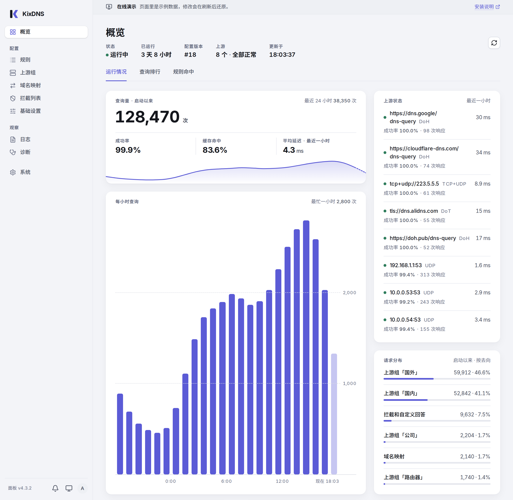

# KixDNS Panel

[简体中文](./README.md) | **English**

A web panel for your own DNS server. Set up routing rules and blocklists with forms, and see which rule each query matched and who answered it. The DNS kernel is KixDNS, written in Rust. One command installs everything, or [try the demo](https://tuoro.github.io/kixdns-panel/) first: nothing to install, sample data only, and changes are gone on refresh.

**The panel's interface and the installer's messages are in Chinese only for now.**



## What it does

- **Overview**: query volume, success rate, cache hits, latency and hourly trends, upstream status, where requests went, rule hits and query rankings
- **Configuration**: edit rules, upstream groups, domain mappings, blocklists and basic settings with forms, or edit the JSON directly; managed GeoIP/GeoSite data (the full package includes GeoSite); KixDNS itself validates a configuration before it is saved, a failed hot reload rolls back automatically, and version history is kept
- **Blocklists**: subscribe to AdGuard and Adblock format lists and hosts files, or write your own rules; updates run daily or weekly, and if a download fails the last good version stays in use, marked with its date
- **Query log**: for every query, which client sent it, which rule it matched, who answered and with what, step by step; search by domain or client, filter by destination, and download; how long it is kept and how much space it takes can be set, never beyond the room left on the device
- **DNS diagnostics**: send a query to the local KixDNS, optionally as a given client IP, and see the rules, cache and upstreams it went through step by step; while editing rules you can try out an unsaved draft first
- **Runtime logs and audit trail**: KixDNS's runtime log live, and a record of every action taken in the panel
- **Kernel updates**: update KixDNS from within the panel to the latest dated release of the fork, or go back to the previous one; a failed activation restores automatically
- **Panel self-update**: one click on the system page updates to the latest stable release, with the digest checked twice and KixDNS left alone
- **OpenWrt**: one command installs it on the router; starting KixDNS takes over port 53 automatically, while dnsmasq keeps DHCP and local host names
- **Docker**: one container, one data directory; the panel and the kernel still update online from the panel, and DNS keeps answering while the panel updates
- **Security**: Argon2id authentication, HttpOnly sessions, CSRF protection and login rate limiting; with systemd and in Docker neither the panel nor the kernel runs as root
- Works on desktop and phone

## Kernel

The kernel is the enhanced build released under dated versions by the fork [tuoro/kixdns](https://github.com/tuoro/kixdns): upstream [olicesx/kixdns](https://github.com/olicesx/kixdns) plus fixes and the panel interface. The panel talks to the DNS data plane only through a local control protocol.

## Install

### Linux (systemd)

Requires x86_64 or ARM64 with GLIBC 2.35 or later (Ubuntu 22.04, Debian 12 or newer), plus `curl`, `jq` and `unzip`:

```bash
curl -fsSL https://raw.githubusercontent.com/tuoro/kixdns-panel/main/scripts/one-click-install.sh | sudo bash
```

Then open the address the installer prints (default port `5738`); the first visit creates the administrator. KixDNS does not start automatically by default: start it from the 系统 (System) page.

If KixDNS is already on the host, the installer explains what migrating would do and, with your agreement, migrates it to the enhanced build: configuration and runtime state are kept, and uninstalling the panel can restore the original KixDNS. If you decline, nothing changes. **Do not expose `5738` directly to the internet**; use an HTTPS reverse proxy for access across networks.

Pinned-version install, manual install, reverse proxies and the permission model are in the [deployment guide](docs/deployment.en.md). Uninstall with `sudo kixdns-panel-uninstall`.

### OpenWrt

OpenWrt 24.10 and 25.12 on x86_64 and arm64. On the router run:

```sh
uclient-fetch -qO- https://raw.githubusercontent.com/tuoro/kixdns-panel/main/deploy/openwrt/one-click-install.sh | sh
```

Then open `http://<router LAN address>:5738`. Starting KixDNS from the 系统 (System) page has it take over port 53: dnsmasq's DNS moves to 5353 and DHCP carries on; stopping it gives everything back. Updates, uninstalling and common settings are in [`deploy/openwrt/`](deploy/openwrt/README.md) (Chinese).

> [!IMPORTANT]
> **On a router, keep flow control on.** Packages newer than v4.3.7 install with it on. An install made with v4.3.7 or earlier has it off, and upgrading leaves that as it is: turn it on at 配置 → 基础设置 → 智能流控 (Config → Basic settings → Flow control), save, and restart KixDNS when the panel asks. A router has little memory: without it, when a device floods queries while the upstream answers slowly, the system may kill the kernel for running out of memory and DNS goes down. With it on, the device sending too much gets SERVFAIL and the other devices resolve as usual. [Details (Chinese)](deploy/openwrt/README.md#启用-dns)

### Docker

The image is [`ghcr.io/tuoro/kixdns-panel`](https://github.com/tuoro/kixdns-panel/pkgs/container/kixdns-panel), x86_64 and arm64, published with every stable release. The `latest` tag is the newest stable release; you can also pin the major.minor version (such as `4.4`) or the full version (such as `4.4.1`). The panel and the kernel share one container, and all data lives in `./data`.

Start it with compose in an empty directory:

```bash
mkdir kixdns-panel && cd kixdns-panel
curl -fsSLO https://raw.githubusercontent.com/tuoro/kixdns-panel/main/deploy/docker/compose.yaml
docker compose up -d
```

Without compose:

```bash
mkdir kixdns-panel && cd kixdns-panel
docker run -d --name kixdns-panel --network host --restart unless-stopped \
  -v "$PWD/data:/data" ghcr.io/tuoro/kixdns-panel:latest
```

Then open `http://<host address>:5738` to create the administrator. Host networking is the default (only then does the kernel see the real client IPs); KixDNS starts with the container and listens on the host's port 53. On hosts where systemd-resolved holds port 53, such as Ubuntu, read the [Docker section of the deployment guide](docs/deployment.en.md#docker) first.

- **Updates**: the panel and the kernel both update online from the 系统 (System) page, with no new image needed; pulling a new image works too: `docker compose pull && docker compose up -d`
- **Backup**: only `./data/config` (the kernel config and the panel database)
- Moving an existing install, bridge networking, environment variables and the data directory are covered in the [deployment guide](docs/deployment.en.md#docker)

What changed in each version is in [Releases](https://github.com/tuoro/kixdns-panel/releases).

## Development

```bash
cargo test --workspace --locked
cd web && npm ci && npm test
VITE_DEMO_MODE=true npm run dev   # demo data mode
```

## Documentation

- [Deployment guide](docs/deployment.en.md): installation, permissions, kernel updates, operations and uninstalling
- [OpenWrt](deploy/openwrt/README.md) (Chinese): installing and using it on a router; [implementation, building and packaging](deploy/openwrt/DEVELOPMENT.md)
- [Architecture](docs/architecture.en.md): component boundaries, build pipeline and security design
- [Enhanced control protocol v1](docs/control-protocol-v1.en.md): the local interface between the panel and KixDNS
- [Configuration capability contract](docs/config-capabilities.en.md): compatibility rules for new configuration fields

License: GPL-3.0-only.
