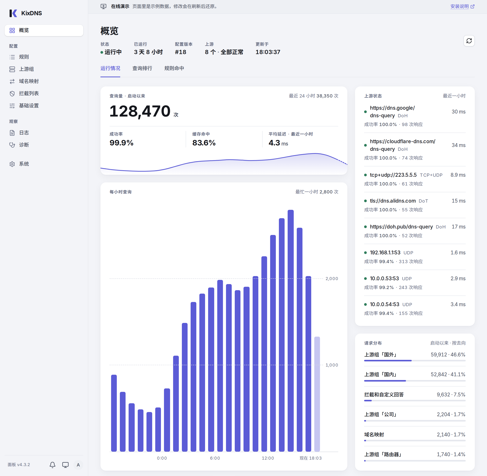

# KixDNS Panel

[简体中文](./README.md) | **English**

A web panel for your own DNS server. Set up routing rules and blocklists with forms, and see which rule each query matched and who answered it. The DNS kernel is KixDNS, written in Rust. One command installs everything, or [try the demo](https://tuoro.github.io/kixdns-panel/) first: nothing to install, sample data only, and changes are gone on refresh.

**The panel's interface and the installer's messages are in Chinese only for now.**



## What it does

- **Overview**: query volume, success rate, cache hits, latency and hourly trends, upstream status, where requests went, rule hits and query rankings
- **Configuration**: edit rules, upstream groups, domain mappings, blocklists and basic settings with forms, or edit the JSON directly; managed GeoIP/GeoSite data (the full package includes GeoSite); KixDNS itself validates a configuration before it is saved, a failed hot reload rolls back automatically, and version history is kept
- **Blocklists**: subscribe to AdGuard and Adblock format lists and hosts files, or write your own rules; updates run daily or weekly, and if a download fails the last good version stays in use, marked with its date
- **Query log**: for every query, which client sent it, which rule it matched, who answered and with what, step by step; search by domain or client, filter by destination, and download
- **DNS diagnostics**: send a query to the local KixDNS, optionally as a given client IP, and see the rules, cache and upstreams it went through step by step; while editing rules you can try out an unsaved draft first
- **Runtime logs and audit trail**: live KixDNS journal, and a record of every action taken in the panel
- **Kernel updates**: update KixDNS from within the panel to the latest dated release of the fork, or go back to the previous one; a failed activation restores automatically
- **Panel self-update**: one click on the system page updates to the latest stable release, with the digest checked twice and KixDNS left alone
- **Security**: Argon2id authentication, HttpOnly sessions, CSRF protection and login rate limiting; the panel process does not run as root
- Works on desktop and phone

## Kernel

The kernel is the enhanced build released under dated versions by the fork [tuoro/kixdns](https://github.com/tuoro/kixdns): upstream [olicesx/kixdns](https://github.com/olicesx/kixdns) plus fixes and the panel interface. The panel talks to the DNS data plane only through a local control protocol.

## Install

Requires Linux x86_64/ARM64 with systemd and GLIBC 2.35 or later (Ubuntu 22.04, Debian 12 or newer). The one-line install also needs `curl`, `jq` and `unzip`.

```bash
curl -fsSL https://raw.githubusercontent.com/tuoro/kixdns-panel/main/scripts/one-click-install.sh | sudo bash
```

Then open the address the installer prints (default port `5738`); the first visit creates the administrator. KixDNS does not start automatically by default: start it from the 系统 (System) page.

If KixDNS is already on the host, the installer explains what migrating would do and, with your agreement, migrates it to the enhanced build: configuration and runtime state are kept, and uninstalling the panel can restore the original KixDNS. If you decline, nothing changes. **Do not expose `5738` directly to the internet**; use an HTTPS reverse proxy for access across networks.

Pinned-version install, manual install, reverse proxies, the permission model and uninstalling are in the [deployment guide](docs/deployment.en.md). What changed in each version is in [Releases](https://github.com/tuoro/kixdns-panel/releases).

Uninstall:

```bash
sudo kixdns-panel-uninstall
```

## Development

```bash
cargo test --workspace --locked
cd web && npm ci && npm test
VITE_DEMO_MODE=true npm run dev   # demo data mode
```

## Documentation

- [Deployment guide](docs/deployment.en.md): installation, permissions, kernel updates, operations and uninstalling
- [Architecture](docs/architecture.en.md): component boundaries, build pipeline and security design
- [Enhanced control protocol v1](docs/control-protocol-v1.en.md): the local interface between the panel and KixDNS
- [Configuration capability contract](docs/config-capabilities.en.md): compatibility rules for new configuration fields

License: GPL-3.0-only.
