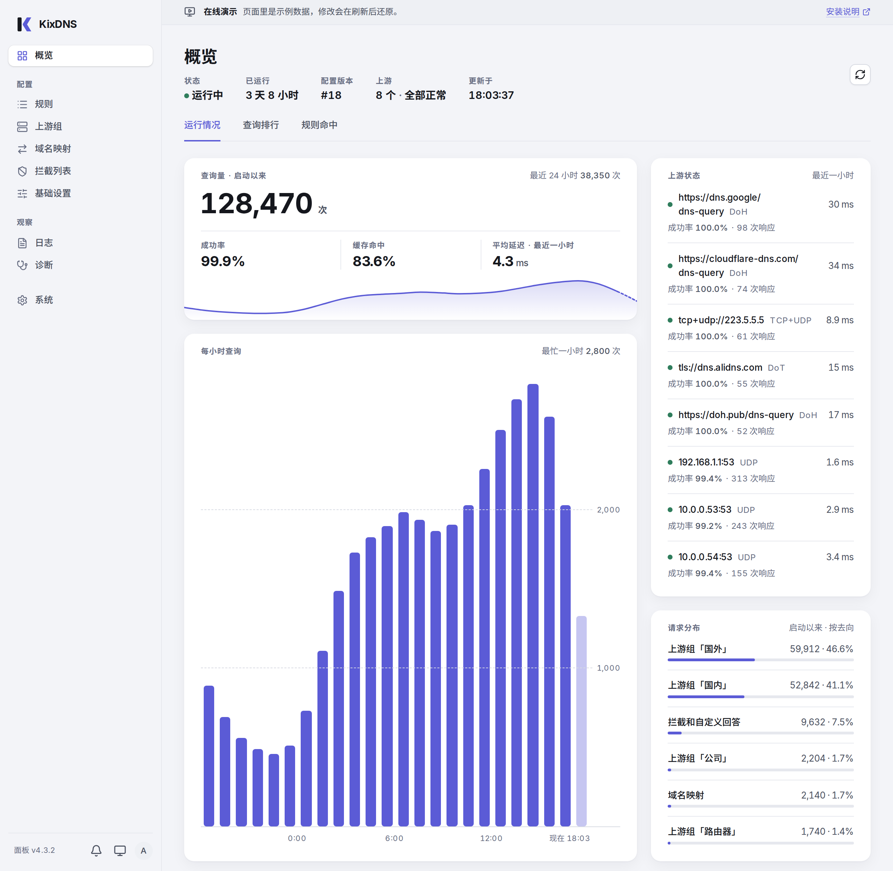

# KixDNS Panel

**简体中文** | [English](./README.en.md)

自建 DNS 的 Web 面板。用表单配分流规则和拦截列表，还能看到每一次查询走了哪条规则、谁回答的。内核是 Rust 写的 KixDNS，一条命令就能装好，也可以先[在线试用](https://tuoro.github.io/kixdns-panel/)：不用安装，用的是示例数据，修改刷新后还原。



## 能做什么

- **运行概览**：查询量、成功率、缓存命中、延迟与每小时趋势，上游状态、请求分布、规则命中、查询排行
- **配置管理**：规则、上游组、域名映射、拦截列表、基础设置用表单编辑，也可以直接改 JSON；GeoIP/GeoSite 数据托管（完整包自带 GeoSite）；保存前由 KixDNS 自身校验，热加载失败自动回滚，保留版本历史
- **拦截列表**：订阅 AdGuard、Adblock 格式的拦截列表和 hosts 文件，也可以自己写规则；按天或按周自动更新，下载失败时继续使用上一次成功的版本，并标明日期
- **查询日志**：每一次查询从哪个客户端来、命中哪条规则、谁回答的、回了什么，逐步看处理过程；按域名或客户端搜索、按去向筛选，可以下载；保存多久、最多占用多少可以设，不会超过设备剩余的空间
- **DNS 诊断**：对本机 KixDNS 发起查询，可以指定客户端 IP，逐步展示命中的规则、缓存与上游；改规则时可以先拿没保存的草稿试跑
- **运行日志与操作审计**：实时查看 KixDNS 的运行日志，面板里的每次操作都有记录
- **内核更新**：在面板内把 KixDNS 更新到 fork 最新发布的日期版本，或回到上一个，激活失败自动恢复
- **面板自更新**：系统页一键更新到最新正式版，双重校验摘要，不动 KixDNS
- **OpenWrt**：路由器上一条命令装好；启动 KixDNS 时自动接管 53 端口，dnsmasq 照常管 DHCP 和局域网主机名
- **Docker**：一个容器、一个数据目录；面板和内核照样在面板里在线更新，更新面板时 DNS 不断
- **安全**：Argon2id 认证、HttpOnly 会话、CSRF 防护、登录限流；systemd 版和 Docker 版的面板、内核都不以 root 运行
- 桌面与手机均可用

## 内核

内核是 fork [tuoro/kixdns](https://github.com/tuoro/kixdns) 按日期版本发布的增强版：上游 [olicesx/kixdns](https://github.com/olicesx/kixdns) 加修复，再加面板接口。面板只通过本机控制协议与 DNS 数据面通信。

## 安装

### Linux（systemd）

需要 x86_64 或 ARM64，GLIBC 2.35 及以上（Ubuntu 22.04、Debian 12 或更新），另需 `curl`、`jq`、`unzip`：

```bash
curl -fsSL https://raw.githubusercontent.com/tuoro/kixdns-panel/main/scripts/one-click-install.sh | sudo bash
```

装完访问安装器输出的地址（默认端口 `5738`），首次访问创建管理员。KixDNS 默认不自动启动，在「系统」页启动即可。

主机上已有 KixDNS 时，安装器会说明迁移会做什么，并在你同意后迁移为增强版：配置和运行状态保留，卸载面板时可恢复原来的 KixDNS；不同意则什么都不改。**不要把 `5738` 直接暴露到公网**，跨网络访问请走 HTTPS 反向代理。

固定版本安装、手动安装、反向代理、权限模型见[部署指南](docs/deployment.md)。卸载：`sudo kixdns-panel-uninstall`。

### OpenWrt

支持 OpenWrt 24.10 和 25.12，x86_64 和 arm64。在路由器上执行：

```sh
uclient-fetch -qO- https://raw.githubusercontent.com/tuoro/kixdns-panel/main/deploy/openwrt/one-click-install.sh | sh
```

装完打开 `http://<路由器 LAN 地址>:5738`。在「系统」页启动 KixDNS 时，它接管 53 端口，dnsmasq 的 DNS 挪到 5353、DHCP 照常；停止时原样还回去。更新、卸载和常用设置见 [`deploy/openwrt/`](deploy/openwrt/README.md)。

> [!IMPORTANT]
> **路由器上要开着智能流控。** 比 v4.3.7 新的安装包装好就开着；用 v4.3.7 及更早版本装的是关的，升级也不会改，请在「配置 → 基础设置 → 智能流控」打开，保存后按提示重启一次 KixDNS。路由器内存小，不开的话，有设备猛发查询、上游又回得慢时，内核可能被系统因为内存不足杀掉，DNS 跟着断；开着时，发得多的那台设备收到 SERVFAIL，别的设备照常解析。[详细说明](deploy/openwrt/README.md#启用-dns)

### Docker

需要 x86_64 或 arm64 的 Linux 主机和 Docker Engine。镜像是 [`ghcr.io/tuoro/kixdns-panel`](https://github.com/tuoro/kixdns-panel/pkgs/container/kixdns-panel)，随每个正式版发布：`latest` 是最新正式版，也有 `4.4`、`4.4.2` 这样的版本标签。面板和内核在一个容器里，两条路径任选一条。

#### 用 docker run

```bash
docker run -d --name kixdns-panel \
  --restart unless-stopped \
  --network host \
  -e TZ=Asia/Shanghai \
  -v /opt/kixdns-panel/data:/data \
  ghcr.io/tuoro/kixdns-panel:latest
```

打开 `http://<主机地址>:5738`，创建管理员（密码至少 12 个字符）之后即可使用。KixDNS 随容器启动，默认听 `0.0.0.0:53`、转给 `1.1.1.1`，在「配置」里改成自己的规则和上游。

- `--network host`：用主机的网络，内核才看得到每台设备的真实 IP，按客户端分流、查询日志和智能流控才按设备算。面板听所有网卡的 `5738`，**不要把它暴露到公网**；只给本机的反向代理用时，加 `-e KIXDNS_PANEL_BIND=127.0.0.1:5738`
- `-v /opt/kixdns-panel/data:/data`：配置、数据库、在线装的内核和面板都在这个目录里，删了容器也还在。**要备份的只有 `data/config`**（内核配置 `pipeline.json` 和面板数据库 `panel.db`）
- `-e TZ=Asia/Shanghai`：日志和统计用的时区，不设就是 UTC

Ubuntu 这类主机的 53 端口被 systemd-resolved 占着（它听 `127.0.0.53:53`），内核起不来，「系统」页显示启动失败，运行日志里是 `Address in use`。关掉它的本机监听，再到「系统」页点「启动」：

```bash
sudo mkdir -p /etc/systemd/resolved.conf.d
printf '[Resolve]\nDNSStubListener=no\n' | sudo tee /etc/systemd/resolved.conf.d/kixdns.conf
sudo ln -sf /run/systemd/resolve/resolv.conf /etc/resolv.conf
sudo systemctl restart systemd-resolved
```

已经在用 KixDNS 的，第一次启动之前把原来的 `pipeline.json` 放到 `/opt/kixdns-panel/data/config/pipeline.json`，面板会把它导入成第一个版本。不能用 host 网络时，把 `--network host` 换成 `-p 53:53/udp -p 53:53/tcp -p 5738:5738`；这样内核可能只看得到 Docker 网关的地址，取决于 Docker 的网络设置。

日常操作：

```bash
docker logs -f kixdns-panel   # 容器和面板的日志：内核的起停、面板换版本都在这里；内核自己的日志在面板的「日志」页
docker restart kixdns-panel   # 重启
docker rm -f kixdns-panel     # 删除容器，数据留在 /opt/kixdns-panel/data
```

面板和内核都在「系统」页在线更新，不用换镜像，更新面板时 DNS 不断。想换新镜像也可以：`docker pull ghcr.io/tuoro/kixdns-panel:latest`，删掉容器再用上面那条 `docker run` 重建，数据都在。

#### 用 Docker Compose

和上面那条 `docker run` 等价，写成一个文件。新建 `/opt/kixdns-panel/compose.yaml`：

```yaml
services:
  kixdns-panel:
    image: ghcr.io/tuoro/kixdns-panel:latest
    container_name: kixdns-panel
    restart: unless-stopped
    network_mode: host
    environment:
      TZ: Asia/Shanghai
    volumes:
      - ./data:/data
```

在这个目录里启动，之后的操作也都在这里执行：

```bash
cd /opt/kixdns-panel
docker compose up -d
```

`./data` 就是 `/opt/kixdns-panel/data`，和 `docker run` 用的是同一个目录。访问、53 端口和备份同上。

```bash
docker compose logs -f                        # 看日志
docker compose pull && docker compose up -d   # 换新镜像
docker compose down                           # 删除容器，数据留在 ./data
```

面板的监听地址、反向代理、查询日志放内存这些可选参数，以及忘记管理员密码怎么办，见[部署指南的 Docker 一节](docs/deployment.md#docker)。

每个版本的变化见 [Releases](https://github.com/tuoro/kixdns-panel/releases)。

## 开发

```bash
cargo test --workspace --locked
cd web && npm ci && npm test
VITE_DEMO_MODE=true npm run dev   # 演示数据模式
```

## 文档

- [部署指南](docs/deployment.md)：安装、权限、内核更新、运维与卸载
- [OpenWrt](deploy/openwrt/README.md)：在路由器上安装和使用；[实现、编译和打包](deploy/openwrt/DEVELOPMENT.md)
- [系统架构](docs/architecture.md)：组件边界、构建流水线与安全设计
- [增强控制协议 v1](docs/control-protocol-v1.md)：面板与 KixDNS 之间的本机接口
- [配置能力契约](docs/config-capabilities.md)：新配置字段的兼容规则

许可证：GPL-3.0-only。
